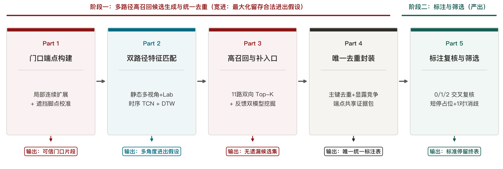
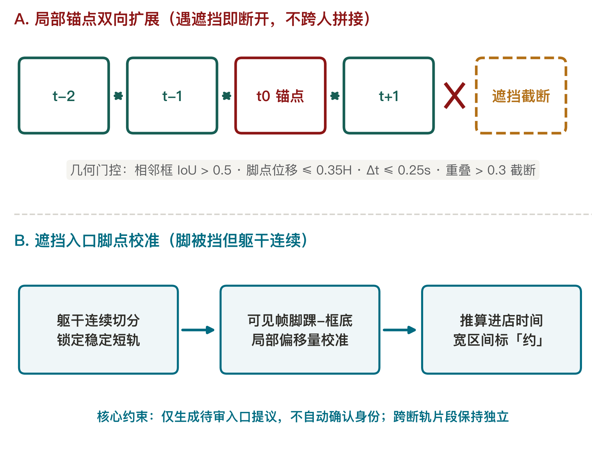
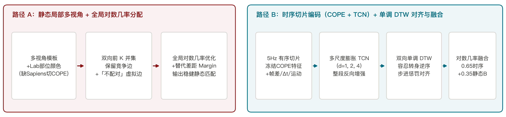
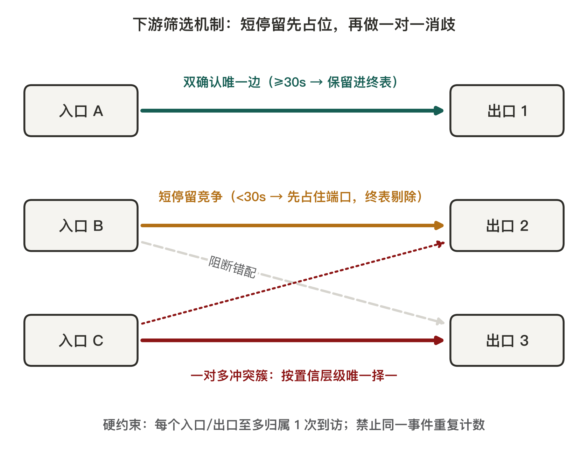

# Doorway Dwell-Time Reconstruction Pipeline

> 面向店铺/商铺门口监控视频的**客户进出配对与停留时长重建**开源工作流。  
> 不依赖脆弱的全店跨区域长轨迹追踪，通过 **「局部端点构建 → 静态与时序双路匹配 → 多通道高召回与遮挡补全 → 主键去重与证据封装 → 分层标注与消歧筛选」** 五阶段框架，实现高召回、可追溯、可计数的停留时长提取。

> **开源说明**：本仓库包含完整的方法实现、跨阶段调度器、去重汇总与标注回填流水线、离线审核界面及方法展示幻灯片（[`docs/methodology_slides.pptx`](docs/methodology_slides.pptx)）；**不包含**任何原始监控视频、人物图像/裁剪、私有标注数据集或预训练权重。

---

## 1. 总体流程划分（Part 1 – Part 5）



整套流程划分为**两大阶段、五个功能解耦的 Part**：

- **阶段一（Part 1 – Part 4）：宽进 · 高召回候选生成与统一聚合**
  不在前端就用单一阈值硬配对，而是保留静态多视角、时序顺序建模、多通道双向检索与遮挡补入口的全部合法假设，并按 `(entry_event, exit_event)` 去重归并到同一张审核表中。
- **阶段二（Part 5）：严出 · 分层标注复核与终表筛选**
  将多轮历史审核与视觉大模型全量复核结果汇入统一表，先由不足 30 秒的短停留竞争项在二分图中占住端点防错配，再完成一对一端点消歧，最终剔除短停留并导出标准三列终表（`进入时间 / 出店时间 / 停留时间`）。

---

## 2. 所有方法的意义总览（为什么需要 A–K, R, N？）

| 阶段 / 编号 | 方法名称 | 核心意义（解决什么痛点） | 关键技术做法 | 对应源码 |
| :--- | :--- | :--- | :--- | :--- |
| **Part 1** | 门口端点构建 | 解决跨店追踪断轨与串人污染 | 锚点局部连续扩展（`IoU>0.5`、`Δfoot≤0.35H`、`Δt≤0.25s`、`overlap>0.3` 截断）+ 遮挡脚踝偏移校准 | `stages/01_endpoints/` |
| **A** | 多视角模板匹配 | 解决单帧背影/侧身判别力弱 | 挑选清晰多视角统计量互比；缺失主模型时自动回退独立校准的 COPE | `stages/02_static_matching/` |
| **B** | 服装部位颜色增强 | 解决全局特征忽视上下衣色差 | 提取上/下身中央区域 Lab 色彩直方图作互补证据（无需重型语义分割） | `stages/02_static_matching/` |
| **C** | 场景连续变化适配 | 解决跨视角光照与尺度漂移 | 使用本地连续变化正样本与同帧空间分离负样本进行无泄漏校准 | `stages/02_static_matching/` |
| **D / E** | 阶梯阈值覆盖扩展 | 解决严格阈值导致的漏配对 | 逐步放宽全局对数几率接纳阈值与替代差距（Margin），扩大合理覆盖 | `stages/02_static_matching/` |
| **K** | 同行上下文辅助 | 解决结伴同行人员衣着混淆 | 引入门口同帧同行人上下文线索辅助区分伴随进出 | `stages/02_static_matching/` |
| **F** | 连续帧静态对照 | 剥离验证“加帧”与“建模顺序”收益 | 使用同批连续帧但不建模时序，作为时序网络的严格静态基线 | `stages/03_temporal_matching/` |
| **G / H** | TCN + DTW 顺序建模 | 解决进出转身导致的剧烈外观变化 | 冻结 COPE + 多尺度膨胀残差 TCN（`d=1,2,4`）+ 整段反向增强 + 单调 DTW 对齐 | `stages/03_temporal_matching/` |
| **I / J** | 时序与静态对数融合 | 兼顾时序动态演化与静态外观稳健性 | 以 `0.65` 时序评分 + `0.35` 静态 `B` 对数几率融合，缺片段端点平滑回退 | `stages/03_temporal_matching/` |
| **R** | 多通道双向高召回 | 解决单一方案互有盲区、彼此分歧大 | 并行聚合多条异构检索通道做双向 Top-K 并集；LR 仅排优先级不删候选 | `stages/04_recall_aggregation/` |
| **N** | 反馈双模型与补入口 | 解决已有正例线索与遮挡入口未充分利用 | `LR + HistGradientBoosting` 反馈挖掘 + 正例模板回捞 + 姿态序列重挖遮挡入口 | `stages/05_feedback_mining/` |

---

## 3. 各 Part 详细说明

### Part 1：门口端点构建与遮挡脚点恢复

- **局部连续性扩展**：围绕真实过线锚点向前后数秒扩展连续人体框；一旦相邻框重叠或行人交叉重叠（`overlap > 0.3`）立即截断，跨断轨片段保持独立不强拼。
- **遮挡入口恢复**：当脚部被遮挡但躯干连续时，按躯干置信度与几何连续性切分稳定段，并利用同段可见帧的「脚踝—框底偏移量」回推过线时间；不确定时间区间（`>0.6s`）显式标示「约」。

### Part 2：双路径配对（静态全局分配 vs 时序顺序对齐）

- **静态路径**：放弃过严的“双向互为第一”，保留**双向前 K 并集**，在包含「不配对选项」的二分图中最大化相对拒绝门槛的对数几率，并施加**全局替代差距（Alternative Margin）**约束。
- **时序路径**：提取门口 `5Hz` 连续有序裁剪，将冻结 COPE 特征与帧间特征差、`Δt`、归一化框运动量输入膨胀残差 TCN（`d=1, 2, 4`），配合整段反向增强与双向单调 DTW，精准应对“背影进、正身出”的朝向逆转。

### Part 3：多通道高召回汇总（R）与反馈挖掘（N）
- **高召回汇总（`R`）**：聚合静态、时序、COPE、Sapiens 与 DTW 多路检索通道，做双向 Top-K 并集（同时允许缺连续序列的端点以单锚点上下文入池并显式标示），再用正则化逻辑回归**只排送审优先级、不删候选**。
- **反馈挖掘与补入口（`N`）**：利用无分歧历史正负样本训练 `LogisticRegression + HistGradientBoosting` 双模型，并从已确认正例提炼多视角模板回捞遗漏配对；同时扫描全事件姿态序列补回遮挡漏检入口（保留全部达标出口，不截断）。

### Part 4：唯一主键去重与自包含证据封装
- 以 `pair_id = Ixxxx_Oyyyy`（入口事件编号 + 出口事件编号）作为全流程唯一主键，将多路产出合并为单一标注集合，无损保留 `source_methods` 血缘与事件链变体。
- 显式给出「同进店其他配法」「同出店其他配法」竞争计数，通过 `workflow/review.html` 一键跳转对比竞争行。
- 图像裁剪、上下文缩略图与视频切片按端点只存一次；批量模型任务 JSONL 刻意屏蔽排序分与历史标签，防止答案暗示。

### Part 5：分层标注协议与下游确定性筛选

1. **分层三值标注与动作校验**：严格区分 `0`（异人）/ `1`（同人）/ `2`（证据不足，绝不当负样本），新补入口额外校验「进店动作成立」（是/否/不确定）；跨轮冲突保留为「分歧」不暗箱投票覆盖。
2. **短停留竞争占位与 `<30s` 剔除**：不足 30 秒的合法配对先在二分图中占住对应端点以防真实短访入口错配给更晚他人出口，消歧完成后再统一剔除。
3. **二分图一对一端点消歧**：每个入口和出口至多归属 1 次到访（允许同一顾客多次进出，分属不同事件对）；经 `pipeline.py import-labels` 按 `pair_id` 回填后导出最终三列停留表（`进入时间 / 出店时间 / 停留时间`）。

---

## 4. 仓库目录结构

```text
doorway-dwell-pipeline/
├── README.md                          # 方法全景与使用指南（本文件）
├── LICENSE                            # MIT License
├── requirements.txt                   # Python 依赖（pipeline 仅需标准库，上游模型阶段见列表）
├── package.json                       # Node.js XLSX 导出依赖说明
├── docs/
│   ├── methodology_slides.pptx        # 方法展示幻灯片（Stanford 极简风格，无具体数据集数字）
│   ├── WORKFLOW_GUIDE.md              # 详细工程协议、数据格式 Schema 与操作手册
│   └── assets/                        # 流程架构图与各阶段机制图
├── workflow/
│   ├── config.json                    # 方法目录映射、30 秒短停留门槛与去重配置
│   ├── pipeline.py                    # 核心引擎：收集(refresh) / 重建(build) / 回填(import-labels)
│   ├── run_methods.py                 # 一键调度上游 Part 2–3 模型脚本并接入统一导出
│   ├── export_xlsx.mjs                # 导出单工作表、带下拉验证与证据超链接的 XLSX
│   ├── package.py                     # 打包自包含分发 ZIP（自动解引用媒体软链接）
│   └── review.html                    # 离线网页版证据对比与竞争跳转审核工具
├── stages/
│   ├── 01_endpoints/                  # Part 1：端点连续性重建、状态确认与初始配对器
│   ├── 02_static_matching/            # Part 2A：静态多视角、Lab 部位颜色与全局分配 (A–E, K)
│   ├── 03_temporal_matching/          # Part 2B：5Hz 切片、COPE+膨胀TCN 训练与 DTW 融合 (F–J)
│   ├── 04_recall_aggregation/         # Part 3A：多通道双向高召回与 LR 优先级排序 (R)
│   └── 05_feedback_mining/            # Part 3B：反馈双模型挖掘、遮挡补入口与证据渲染 (N)
└── tests/
    └── test_pipeline_smoke.py         # 脱敏合成数据端到端烟雾测试（标准库可跑）
```

---

## 5. 快速开始

### 5.1 运行端到端烟雾测试（无需原始视频或 GPU）
```bash
python3 -m unittest tests/test_pipeline_smoke.py -v
```

### 5.2 汇总、重建与标注回填（Python 标准库零额外依赖）
将准备好的项目根目录通过 `--project-root`（或环境变量 `DWELL_PROJECT_ROOT`）传入：

```bash
# 1. 从各阶段产出收集、按 Ixxxx_Oyyyy 去重、连接端点媒体并生成统一数据集
python3 workflow/pipeline.py refresh --project-root /path/to/your_project_root

# 2. 基于已有 workflow/inputs/ 快照离线重建同一数据集
python3 workflow/pipeline.py build

# 3. 导入人工或视觉模型标注（支持 .xlsx 或 .csv，按配对编号回填，空值不覆盖旧判）
python3 workflow/pipeline.py import-labels /path/to/annotated.xlsx

# 4. 导出格式化单工作表 XLSX（需安装 Node.js 及 @oai/artifact-tool）
node workflow/export_xlsx.mjs

# 5. 打包为自包含分发包（含流程代码、统一表、离线 HTML 与真实媒体文件）
python3 workflow/package.py --output dist/dwell_bundle.zip
```

### 5.3 在独立目录重跑模型候选生成（Part 2–3）
若已在服务器准备好端点特征与视频片段缓存，可在不覆盖原结果的前提下于新目录完整重跑：

```bash
python3 workflow/run_methods.py \
  --project-root /path/to/your_project_root \
  --run-root /path/to/new_run_output \
  --stages static temporal recall examples \
  --gpu 0
```

> 更多数据输入格式契约、字段定义及下游消歧注意事项，请参阅 [`docs/WORKFLOW_GUIDE.md`](docs/WORKFLOW_GUIDE.md)。
